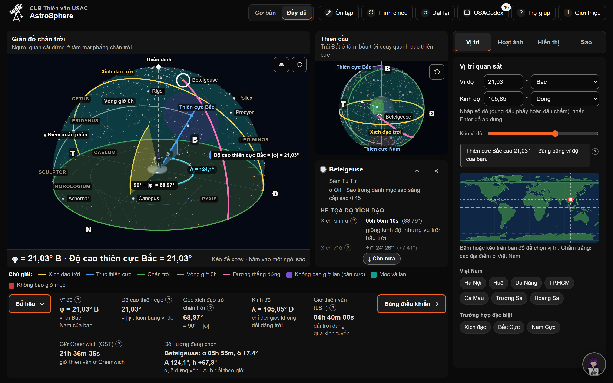
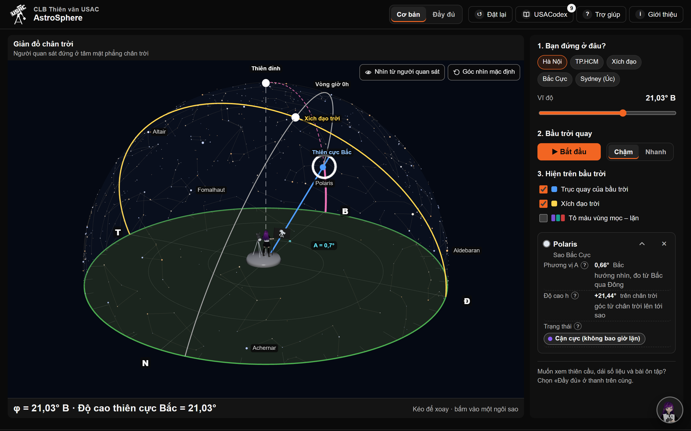
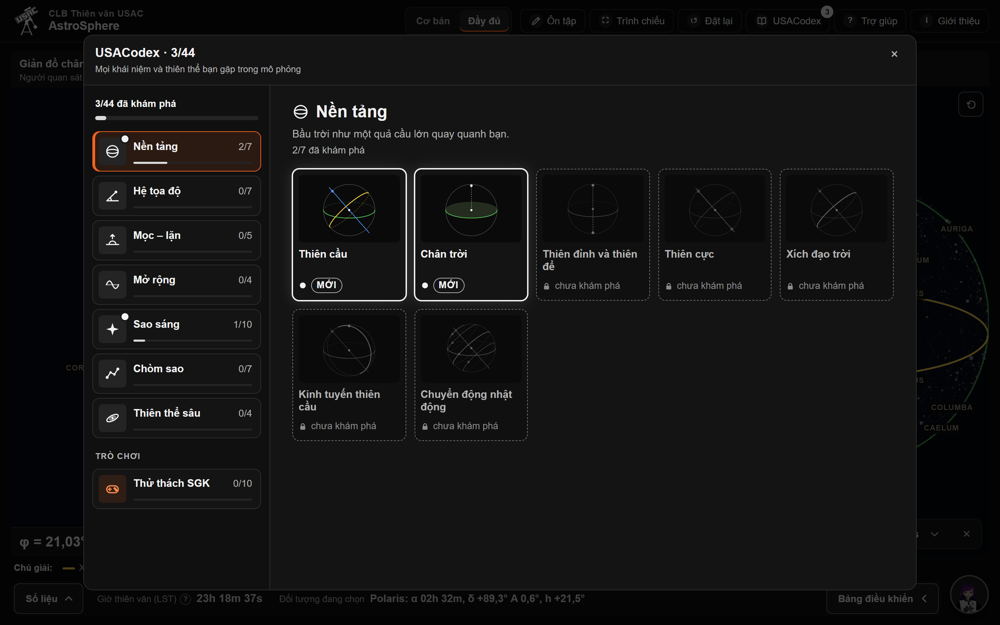
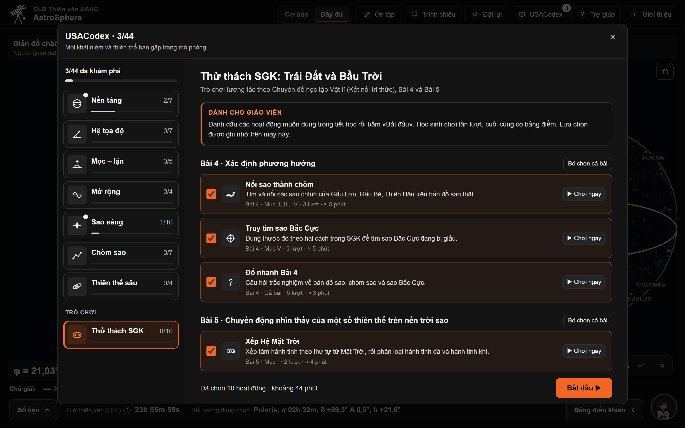
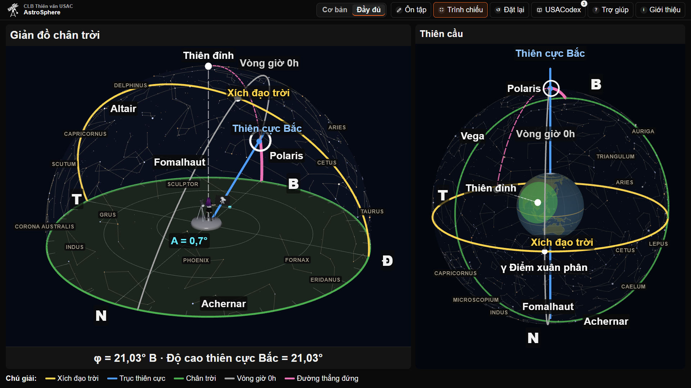
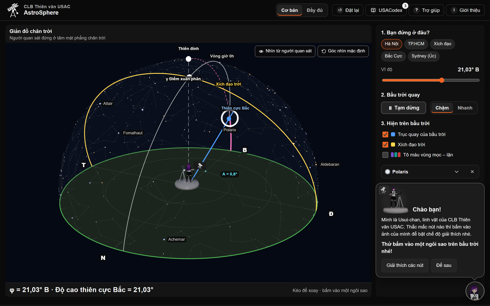
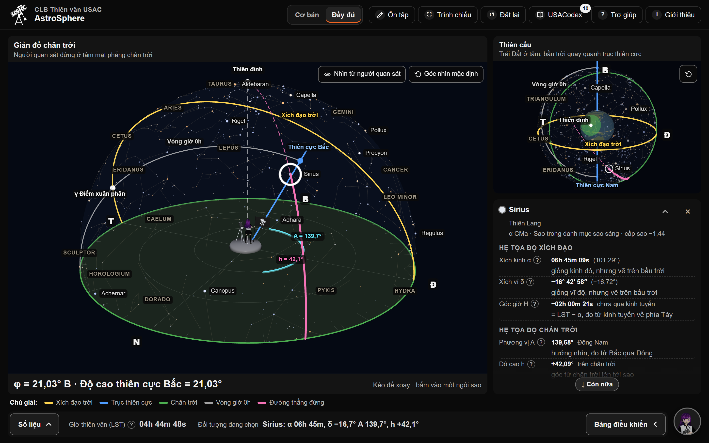
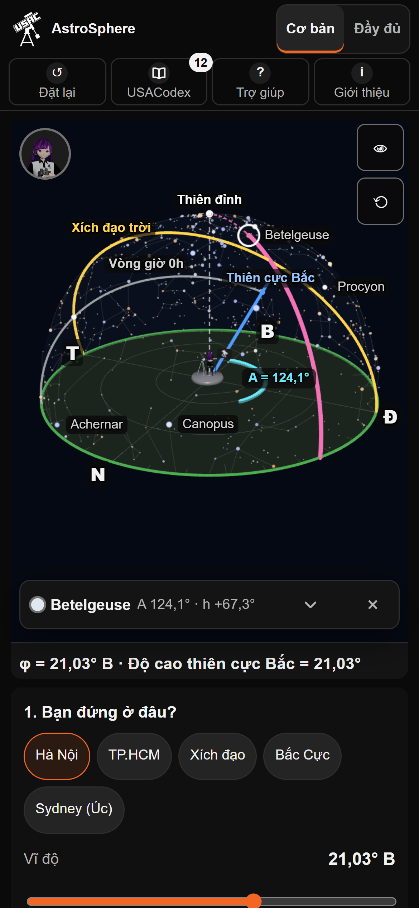

<div align="center">


# AstroSphere

[Tiếng Việt](README.md) · **English**

**An interactive celestial-coordinate simulator, built for Vietnamese learners**

Spin the sky in your browser to see why stars rise and set, and why Polaris barely moves.

[](https://astrosphere.clbtvusac.com)

[](LICENSE)
[](LICENSE-CONTENT.md)




</div>

> **Note:** the app's interface is entirely in Vietnamese. This page describes the project for English-speaking visitors.

## About

**AstroSphere** is developed by the **Astronomy Education and Experimental Science project group of the USAC Astronomy Club** (VNUHCM – University of Science, Ho Chi Minh City, Vietnam). It is a visual tool for teaching, learning and self-studying basic astronomy. The app is a static web page: nothing to install, no sign-in, and it works offline.

AstroSphere helps learners build intuition for three ideas:

1. Why the sky appears to rotate, and why **the altitude of the celestial pole always equals the observer's latitude**.
2. How the **equatorial system** (α, δ, H) relates to the **horizontal system** (A, h).
3. Which stars **rise and set**, which **never set** (circumpolar) and which **never rise**, depending on where you stand.

## Features

| | |
|---|---|
| 🔭 **Two synchronized 3D views** | A horizon diagram (observer at the centre) and a celestial sphere (Earth at the centre). Drag to rotate, scroll or pinch to zoom. |
| ⭐ **The real sky** | About 1,300 bright stars, with lines and names for all 88 constellations. International names in the sky, Vietnamese names in the info card. |
| 🎚️ **Two modes** | *Cơ bản* (Simple) for newcomers: three numbered steps. *Đầy đủ* (Full): four control panels, a live data bar, review tasks and presentation mode. |
| 🔗 **Numbers linked to shapes** | Hover a number and the matching part of the drawing lights up in both views, and the other way round. |
| 📖 **USACodex** | A 44-entry handbook in 7 categories that unlocks as you meet each concept in the simulation. |
| 🎮 **Thử thách SGK** (Textbook Challenge) | 10 interactive activities for Lessons 4 and 5 of the Vietnamese physics topic "Earth and Sky". The teacher picks the activities; a scoreboard closes the session. |
| 🚀 **Bay vào vũ trụ** (Fly into space) | Leave Earth and fly to the Sun, the eight planets, the Moon, about 1,300 stars and 60 confirmed exoplanets, all at their real positions and distances. |
| ✏️ **Ôn tập** (Review) | 12 tasks with hints, explanations and scoring. |
| 🖥️ **Presentation mode** | Press `F`: full screen, thicker lines and larger labels for a projector. |
| 💬 **Usui-chan** | The club mascot explains every control when you hover or tap it. |
| 📱 **Mobile and offline** | Touch interface, installable to the home screen (PWA), runs with no connection. |

## Screenshots

| Simple mode | USACodex |
|---|---|
|  |  |
| **Textbook Challenge** | **Presentation mode** |
|  |  |

<details>
<summary>More screenshots</summary>

| Usui-chan greets a first-time visitor | Sirius in Full mode |
|---|---|
|  |  |

<p align="center"></p>

</details>

## What you can do

**Observer location.** Type a latitude and longitude, drag the latitude slider, or click the built-in world map. Quick buttons cover Hà Nội, Huế, Đà Nẵng, Ho Chi Minh City, Cà Mau, the Trường Sa and Hoàng Sa islands, the Equator and both Poles.

**Animation.** Run continuously, run one sidereal day and stop, or step hour by hour. One sidereal day takes 5–60 seconds. A sidereal-time slider turns the sky by hand, and a "now" button jumps to the current time.

**Display.** The 0h hour circle, celestial equator, the sky below the horizon, three shaded zones (circumpolar, rise-and-set, never-rise), the equator–horizon angle, pole altitude, zenith and nadir, meridian, vertical circle, horizontal and equatorial grids, the ecliptic, the Sun by date, and the galactic equator.

**Stars.** 16 constellation templates, random stars, custom stars by (α, δ) in several formats, and short or long star trails.

**Info card.** α, δ, H, A, h, visibility class, and the sidereal time and azimuth at rising, transit and setting, plus time above the horizon.

**Fly into space.** Open it from the top bar in Full mode, or with "Bay tới" (Fly to) in a star's info card. The flight starts above the observer's location, with Earth's axis pointing at Polaris; as you fly out, the stars of a constellation separate at their different distances. Bodies are drawn low-poly, and their shapes and colours are illustrative by type. Every value that is not a measurement is labelled as an estimate or as chosen by the app (for example the orientation of an exoplanet's orbital plane). Controls: drag to orbit, scroll or pinch to approach, double-click to fly to a body, `W` `A` `S` `D` `R` `F` to fly freely, and `Esc` to stop the flight and then return to Earth.

**Keyboard shortcuts.** `Space` play/pause · `←` `→` back/forward one hour · `+` `−` speed · `N` now · `V` reset trails · `C` reset camera · `L` review tasks · `F` presentation · `H` help · `Esc` close or deselect. (`L` and `F` work in Full mode only.)

## Accuracy

- Sidereal time follows the IAU 1982 convention. Coordinate conversions are checked automatically against [astronomy-engine](https://github.com/cosinekitty/astronomy), with errors below 0.1°.
- Star positions use epoch J2000.0. This version does not correct for proper motion, precession, nutation or atmospheric refraction.
- The Earth is drawn far larger than scale on purpose, to make the geometry readable.

## Run it locally

You need Node.js and npm.

```bash
git clone https://github.com/minhtali-usac/AstroSphere.git
```

```bash
cd AstroSphere
```

```bash
npm ci
```

```bash
npm run dev
```

| Command | Purpose |
|---|---|
| `npm run dev` | Vite dev server |
| `npm test` | Unit tests (Vitest) |
| `npm run build` | Type-check (`tsc`), then bundle into `dist/` |
| `npm run preview` | Serve the built bundle |
| `npm run data` | Regenerate the star, constellation and coastline data in `src/data/generated/` |
| `npm run fetch-sky` | Re-fetch Hipparcos parallaxes (CDS VizieR) and the exoplanet list (NASA Exoplanet Archive) into `src/data/fetched/`. Needs a network connection; `.github/workflows/refresh-sky-data.yml` runs it every Monday and opens a PR when the data changes |

Every push to `main` deploys to GitHub Pages through GitHub Actions (`.github/workflows/deploy.yml`).

## Tech stack

- **Vite + TypeScript**, with no UI framework and no web fonts.
- **Three.js** for both 3D views, loaded only after the interface shell is on screen. The entry JavaScript stays within a 90 kB gzip budget.
- **KaTeX** for formulas. USACodex, the Textbook Challenge and Usui-chan are separate chunks that load on demand.
- **PWA**: a service worker precaches every asset, and the running app calls no other server.
- A single `Store`; both views render only from that state, which keeps them in sync.

## Project structure

```
src/
  astro/      Pure maths, no UI dependency (unit tested): sidereal time, coordinate
              conversion, visibility classes, ecliptic, Vietnamese number formatting
  scene/      Three.js code (loaded only through scene/boot.ts): both views, sky and
              horizon layers, trails, label decluttering, semantic colours; flight/ (the
              fly-into-space mode, a lazy chunk)
  runtime/    Frame loop (pauses when hidden) and adaptive quality
  ui/         Control panels, map, info card, dialogs, review tasks, storage, modes
  codex/      USACodex: discovery triggers (in the entry chunk) and the lazy UI
  guide/      Usui-chan: avatar button, first-visit hello, explain mode
  games/      Textbook Challenge: ten interactive activities (lazy chunk)
  data/       Star catalogue, constellations, places, review tasks; generated/ (JSON)
  i18n/       All interface text (vi.json, codex.vi.json, games.vi.json)
  state.ts    The single source of state and its actions
```

Every sky object is built in the equatorial frame and placed in a group whose matrix is `B(frame, φ) · Rz(−LST)`, the same rotation as the formulas in `astro/coords.ts`, so the two views cannot drift apart.

## Acceptance checks

| # | Criterion | How it is verified |
|---|---|---|
| 1 | At φ = 21.03° N the pole is 21.03° high and the equator tilts 68.97° | Unit test (`astro.test.ts`) and the angle labels in the diagram |
| 2 | At φ = 90° every star with δ > 0 is circumpolar; at φ = 0° none is | Unit test |
| 3 | A star with δ = 0° rises due east and sets due west (except at the poles) | Unit test over every latitude from −89° to 89° |
| 4 | The two views are exactly in sync | Unit test `frames.test.ts`: 3D positions in both views match (A, h) to within 10⁻⁹ |
| 5 | A and h differ from astronomy-engine by less than 0.1° | Unit test over 300 random cases |
| 6 | At least 50 FPS with about 1,000 stars | Measured by hand in Chrome before the redesign (about 3.3 ms per frame); `docs/redesign/uat/perf.mjs` checks that playback allocates no geometry. FPS still needs re-measuring on real hardware |
| 7 | No English strings in the interface | Unit test `i18n.test.ts` |

## Contributing

Feedback and bug reports are welcome: open an [issue](https://github.com/minhtali-usac/AstroSphere/issues) or send a pull request. Read [`AGENTS.md`](AGENTS.md) before changing code; it covers the architecture, i18n, performance and accessibility rules. Each commit must pass `npm test` and `npm run build`.

## Data and credits

- Star catalogue and constellation lines: [d3-celestial](https://github.com/ofrohn/d3-celestial) by Olaf Frohn (BSD-3-Clause), with star data originating from the HYG Database.
- Coastlines: [Natural Earth](https://www.naturalearthdata.com/) (public domain) through the `world-atlas` package (ISC).
- Vietnamese constellation names: Vietnamese Wikipedia, "Danh sách chòm sao" (CC BY-SA 4.0).
- Star distances: Hipparcos parallaxes, the new reduction (van Leeuwen 2007, A&A 474, 653; catalogue I/311), through CDS VizieR.
- Exoplanets: NASA Exoplanet Archive, Planetary Systems Composite Parameters table (DOI 10.26133/NEA13). This research has made use of the NASA Exoplanet Archive, which is operated by the California Institute of Technology, under contract with the National Aeronautics and Space Administration under the Exoplanet Exploration Program.
- Planet positions: JPL "Approximate Positions of the Planets" (Standish); the Moon: Meeus, "Astronomical Algorithms", chapter 47. Planet properties: NASA NSSDCA Planetary Fact Sheets; rotation axes: IAU WGCCRE 2015.
- 3D graphics: [Three.js](https://threejs.org/) (MIT). Formulas: [KaTeX](https://katex.org/) (MIT).
- The visual approach draws on educational simulators such as the *Rotating Sky Explorer* (NAAP, University of Nebraska–Lincoln). All code, interface and assets were developed independently by USAC.

Details: [`THIRD-PARTY-NOTICES.md`](THIRD-PARTY-NOTICES.md).

## License

| Part | License |
|---|---|
| Source code | [MIT](LICENSE) |
| Content written by the club (USACodex, Usui-chan's explanations, Textbook Challenge, documentation, screenshots) | [CC BY-NC-SA 4.0](LICENSE-CONTENT.md) |
| The USAC Astronomy Club name and logo, and the Usui-chan mascot | All rights reserved; see [`LICENSE-CONTENT.md`](LICENSE-CONTENT.md) |
| Third-party data and libraries | Their original licenses; see [`THIRD-PARTY-NOTICES.md`](THIRD-PARTY-NOTICES.md) |

## Contact

<div align="center">

**USAC ASTRONOMY CLUB** · Bringing astronomy to the community

[Facebook page](https://www.facebook.com/clbusac) · [clb.usac@gmail.com](mailto:clb.usac@gmail.com) · [astrosphere.clbtvusac.com](https://astrosphere.clbtvusac.com)

</div>
