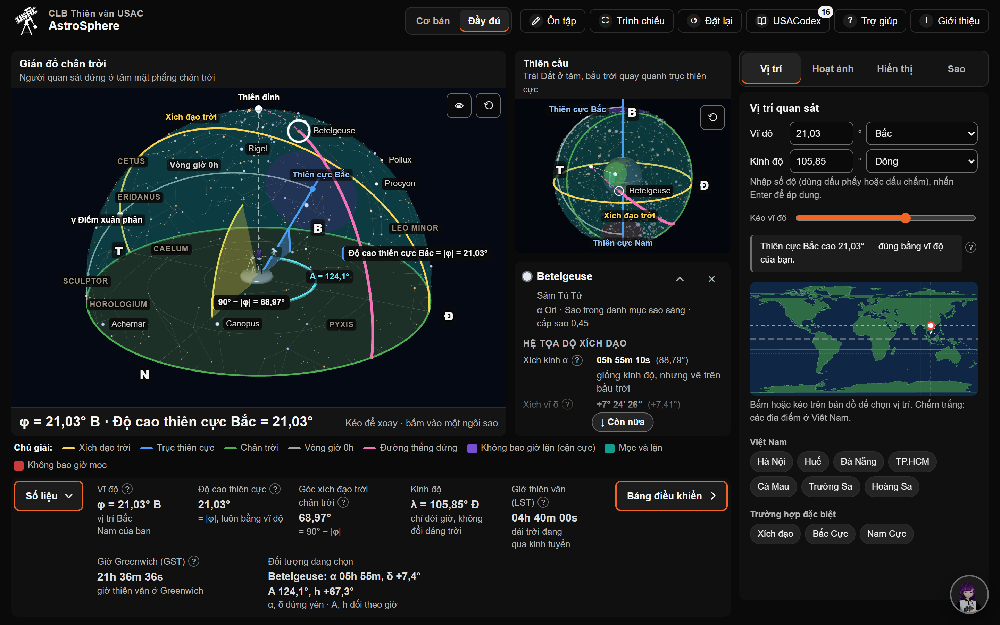
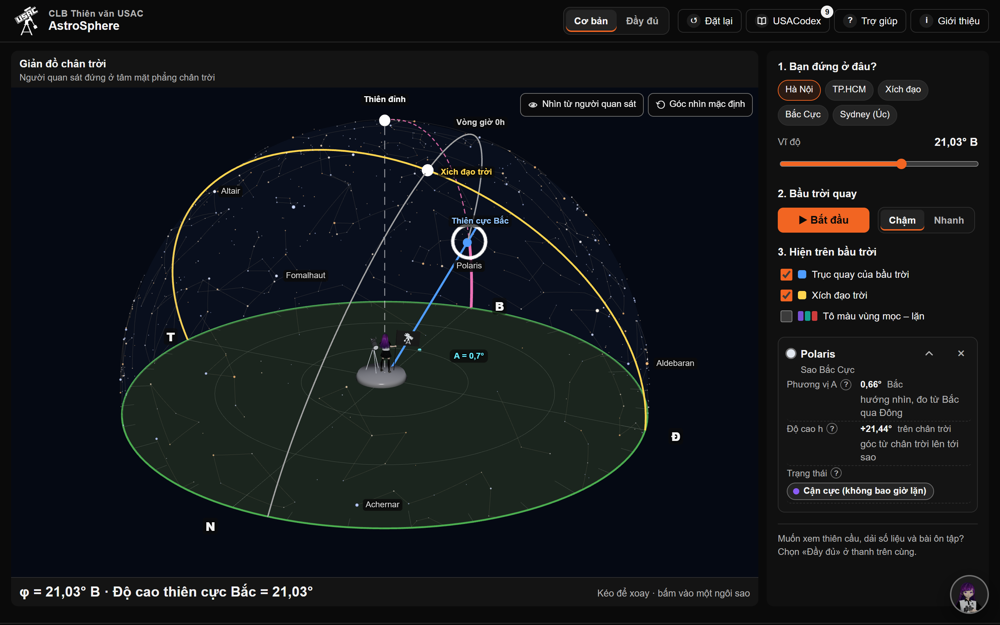
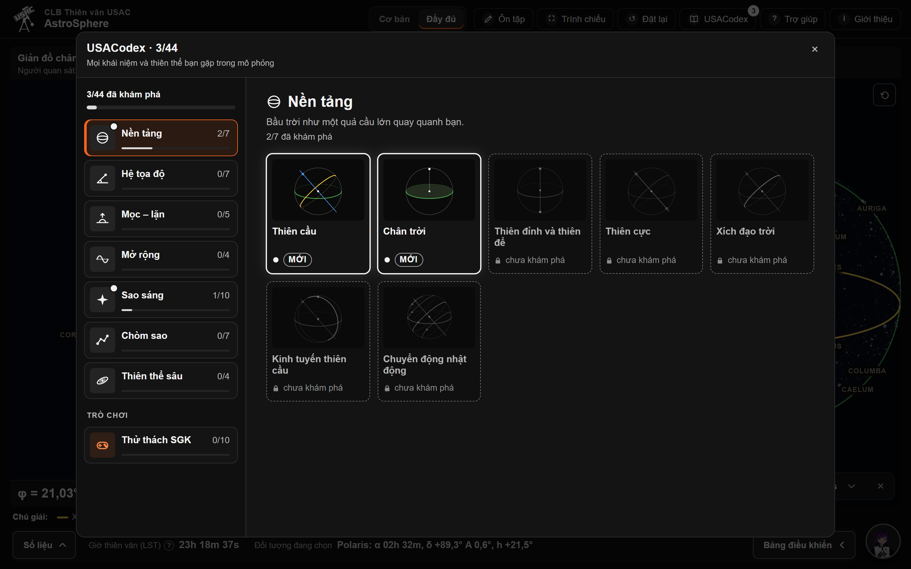
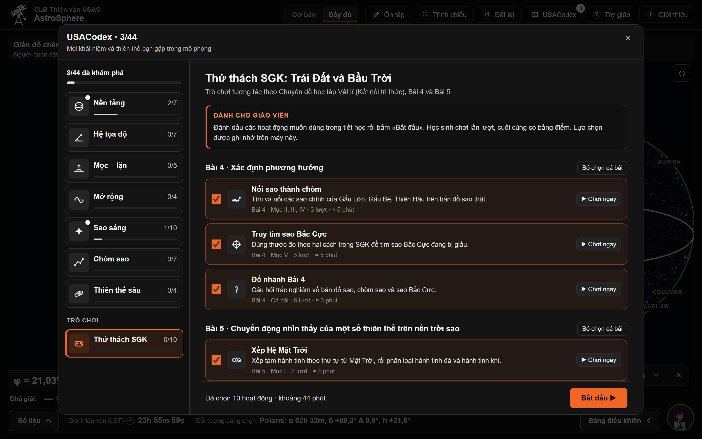
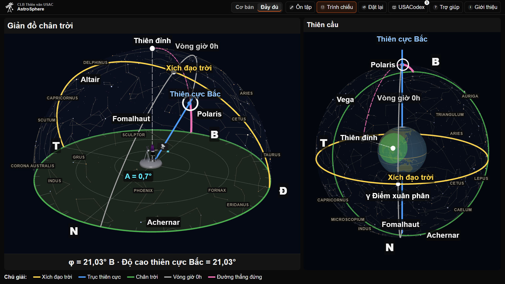
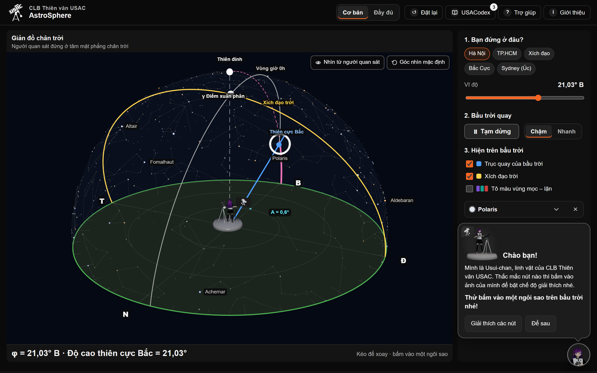
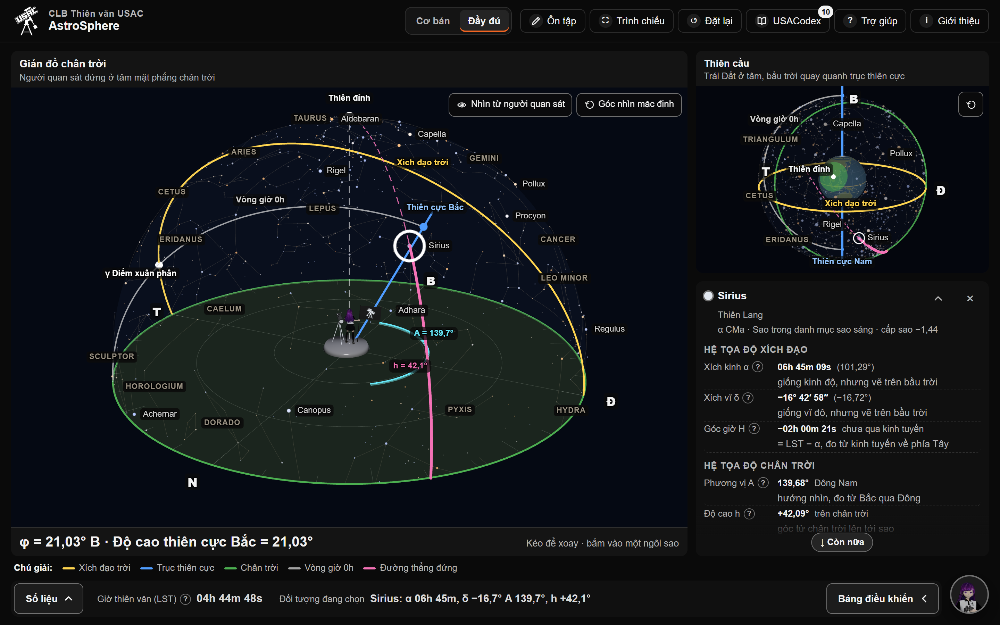
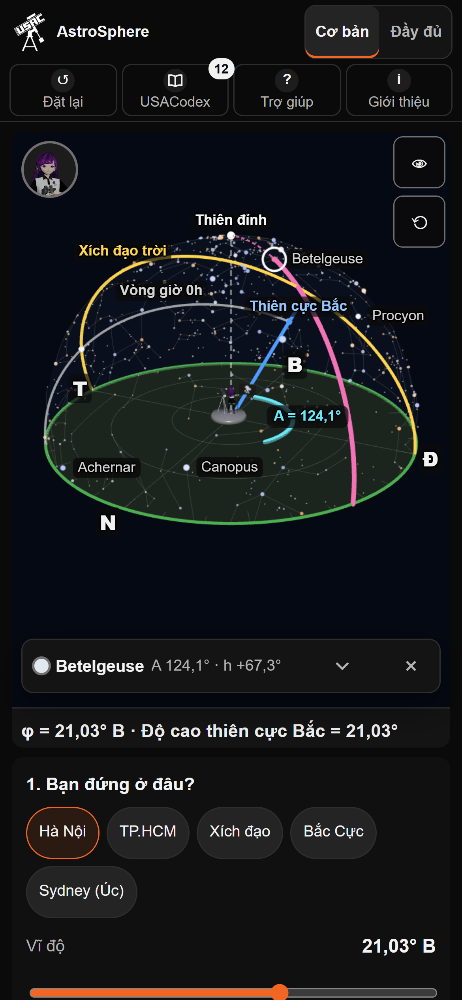

<div align="center">


# AstroSphere

**Tiếng Việt** · [English](README.en.md)

**Hệ thống mô phỏng hệ tọa độ thiên cầu, hoàn toàn bằng tiếng Việt**

Xoay bầu trời ngay trên trình duyệt để hiểu vì sao sao mọc, lặn, và vì sao sao Bắc Cực gần như đứng yên.

[](https://astrosphere.clbtvusac.com)

[](LICENSE)
[](LICENSE-CONTENT.md)




</div>

## Giới thiệu

**AstroSphere** do **Nhóm dự án Giáo dục Thiên văn và Khoa học Thực nghiệm, CLB Thiên văn USAC** (Trường ĐH Khoa học Tự nhiên – ĐHQG TP.HCM) phát triển. Đây là công cụ trực quan phục vụ giảng dạy, học tập và tự học thiên văn cơ bản. Ứng dụng là một trang web tĩnh: không cần cài đặt, không cần đăng nhập, và dùng được cả khi không có mạng.

AstroSphere giúp người học hình thành trực giác về ba điều:

1. Vì sao bầu trời "quay", và vì sao **độ cao thiên cực luôn bằng vĩ độ** của người quan sát.
2. Mối liên hệ giữa **hệ tọa độ xích đạo** (α, δ, H) và **hệ tọa độ chân trời** (A, h).
3. Sao nào **mọc – lặn**, sao nào **không bao giờ lặn** (cận cực), sao nào **không bao giờ mọc**, tùy nơi bạn đứng.

## Tính năng

| | |
|---|---|
| 🔭 **Hai khung nhìn 3D đồng bộ** | Giản đồ chân trời (người quan sát ở tâm) và thiên cầu (Trái Đất ở tâm). Kéo để xoay, cuộn hoặc chụm để phóng to. |
| ⭐ **Bầu trời thật** | Khoảng 1.300 sao sáng, đường nối và tên 88 chòm sao. Tên quốc tế trên bầu trời, tên tiếng Việt trong thẻ thông tin. |
| 🎚️ **Hai chế độ** | *Cơ bản* cho người mới: ba bước đánh số. *Đầy đủ*: bốn bảng điều khiển, dải số liệu, Ôn tập, Trình chiếu. |
| 🔗 **Liên kết số ↔ hình** | Rê chuột vào một con số thì phần hình tương ứng sáng lên ở cả hai khung, và ngược lại. |
| 📖 **USACodex** | Sổ tay 44 mục trong 7 danh mục, "mở khóa" dần khi bạn gặp khái niệm trong mô phỏng. |
| 🎮 **Thử thách SGK** | 10 hoạt động tương tác theo Bài 4 và Bài 5, chuyên đề «Trái Đất và Bầu Trời». Giáo viên chọn hoạt động, cuối buổi có bảng điểm. |
| ✏️ **Ôn tập** | 12 nhiệm vụ có gợi ý, giải thích và chấm điểm. |
| 🖥️ **Trình chiếu** | Phím `F`: toàn màn hình, nét dày, nhãn lớn cho máy chiếu. |
| 💬 **Usui-chan** | Linh vật của CLB giải thích từng nút bấm khi bạn rê chuột hoặc chạm vào. |
| 📱 **Điện thoại và offline** | Giao diện cảm ứng, cài được lên màn hình chính (PWA), chạy khi không có mạng. |

## Hình ảnh

| Chế độ Cơ bản | USACodex |
|---|---|
|  |  |
| **Thử thách SGK** | **Trình chiếu** |
|  |  |

<details>
<summary>Xem thêm ảnh</summary>

| Usui-chan chào người mới | Sirius ở chế độ Đầy đủ |
|---|---|
|  |  |

<p align="center"></p>

</details>

## Chi tiết chức năng

**Vị trí quan sát.** Nhập vĩ độ, kinh độ; thanh trượt vĩ độ; bản đồ thế giới nội bộ (bấm, kéo, phím mũi tên); nút nhanh Hà Nội, Huế, Đà Nẵng, TP.HCM, Cà Mau, Trường Sa, Hoàng Sa, Xích đạo, Bắc Cực, Nam Cực.

**Hoạt ảnh.** Chạy liên tục, chạy một ngày thiên văn rồi dừng, hoặc bước theo giờ; tốc độ 5–60 giây cho một ngày thiên văn; thanh "Giờ thiên văn" để quay bằng tay; nút "Bây giờ".

**Hiển thị.** Vòng giờ 0h, xích đạo trời, mặt dưới chân trời, ba vùng tô màu (cận cực, mọc – lặn, không mọc), góc xích đạo trời – chân trời, độ cao thiên cực, thiên đỉnh và thiên để, kinh tuyến, đường thẳng đứng, lưới chân trời và lưới xích đạo, hoàng đạo, Mặt Trời theo ngày, xích đạo thiên hà.

**Sao.** 16 mẫu chòm sao, sao ngẫu nhiên, nhập (α, δ) theo nhiều định dạng, vết sao ngắn hoặc dài.

**Thẻ thông tin.** α, δ, H, A, h, trạng thái (cận cực / mọc – lặn / không mọc), LST và phương vị lúc mọc, qua kinh tuyến, lặn, thời gian ở trên chân trời.

**Phím tắt.** `Dấu cách` chạy/dừng · `←` `→` lùi/tiến 1 giờ · `+` `−` tốc độ · `N` bây giờ · `V` đặt lại vết · `C` đặt lại góc nhìn · `L` Ôn tập · `F` Trình chiếu · `H` trợ giúp · `Esc` đóng hoặc bỏ chọn. (`L` và `F` chỉ dùng ở chế độ Đầy đủ.)

## Độ chính xác

- Thời gian thiên văn tính theo quy ước IAU 1982. Phép chuyển đổi tọa độ được kiểm chứng tự động với [astronomy-engine](https://github.com/cosinekitty/astronomy), sai số dưới 0,1°.
- Tọa độ thiên thể theo kỷ nguyên J2000.0. Phiên bản hiện tại chưa hiệu chỉnh chuyển động riêng, tuế sai, chương động và khúc xạ khí quyển.
- Mô hình Trái Đất – thiên cầu được phóng đại có chủ đích để làm nổi bật quan hệ hình học.

## Chạy trên máy của bạn

Cần Node.js và npm.

```bash
git clone https://github.com/minhtali-usac/AstroSphere.git
```

```bash
cd AstroSphere
```

```bash
npm ci
```

```bash
npm run dev
```

| Lệnh | Việc làm |
|---|---|
| `npm run dev` | Máy chủ phát triển Vite |
| `npm test` | Unit test (Vitest) |
| `npm run build` | Kiểm tra kiểu (`tsc`) rồi đóng gói vào `dist/` |
| `npm run preview` | Xem thử bản đã đóng gói |
| `npm run data` | Tạo lại dữ liệu sao, chòm sao, lục địa trong `src/data/generated/` |

Mỗi lần đẩy lên nhánh `main`, GitHub Actions tự triển khai lên GitHub Pages (`.github/workflows/deploy.yml`).

## Công nghệ

- **Vite + TypeScript**, không dùng framework giao diện, không dùng web font.
- **Three.js** cho hai khung 3D, chỉ tải sau khi phần khung giao diện đã hiện. JS ban đầu nằm trong ngân sách 90 kB gzip.
- **KaTeX** cho công thức. USACodex, Thử thách SGK và Usui-chan là các gói riêng, chỉ tải khi cần.
- **PWA**: service worker lưu sẵn toàn bộ tài nguyên; lúc chạy ứng dụng không gọi tới máy chủ nào khác.
- Một `Store` duy nhất; cả hai khung nhìn chỉ vẽ từ trạng thái này nên luôn đồng bộ.

## Cấu trúc mã nguồn

```
src/
  astro/        Toán thuần, không phụ thuộc giao diện (có unit test)
    math.ts       lượng giác theo độ, ma trận quay
    time.ts       GMST (IAU 1982), LST = GST + λ, ngày thiên văn
    coords.ts     xích đạo ↔ chân trời (công thức và ma trận quay)
    visibility.ts phân loại sao, cos H₀ = −tan φ · tan δ, phương vị mọc/lặn
    ecliptic.ts   hoàng đạo, Mặt Trời theo ngày, hệ thiên hà
    format.ts     định dạng kiểu Việt Nam (dấu phẩy thập phân, B/N, Đ/T), đọc α/δ
  scene/        Three.js (chỉ tải qua scene/boot.ts): frames, skyLayer, horizonLayer, trails,
                celestialSphere, horizonDiagram, view, declutter (nhãn), emphasis (liên kết số ↔ hình),
                geom (đường cập nhật tại chỗ), colors (màu ngữ nghĩa, không phụ thuộc three)
  runtime/      frameLoop (vòng lặp, tạm dừng khi ẩn), quality (chất lượng thích ứng)
  ui/           Bảng điều khiển, bản đồ, thẻ thông tin, tooltip, hộp thoại, Ôn tập, storage, emphasis,
                mode (Cơ bản | Đầy đủ), simpleControls (dải điều khiển chế độ Cơ bản)
  codex/        USACodex: triggers (luật khám phá, nhẹ, nằm trong gói đầu), ui/diagrams/sky (tải khi mở)
  guide/        Usui-chan: boot (nút ảnh), guide (lời chào, chế độ giải thích; tải khi cần)
  games/        Thử thách SGK: mười hoạt động tương tác (gói riêng, tải khi mở)
  emphasis.ts   Ánh xạ khóa nhấn mạnh ↔ con số ↔ hình 3D
  scenario.ts   Tiện ích dựng tình huống cho Ôn tập
  data/         Danh mục sao, chòm sao, địa điểm, nhiệm vụ học tập; generated/ (JSON)
  i18n/vi.json  Toàn bộ chuỗi giao diện (kể cả lời giải thích của Usui-chan: guide.tip.*)
  i18n/codex.vi.json  Nội dung Codex (tải cùng Codex)
  state.ts      Một nguồn trạng thái duy nhất + các thao tác
  animator.ts   Hoạt ảnh theo thời gian thực
```

Cả hai khung nhìn chỉ render từ một `Store` duy nhất. Mọi đối tượng bầu trời được dựng trong hệ xích đạo
gốc và đặt vào nhóm có ma trận `B(khung, φ) · Rz(−LST)` — cùng phép quay như công thức ở `astro/coords.ts`,
nên hai khung đồng bộ tuyệt đối. Vết sao là cung cố định trên vòng xích vĩ trong hệ quay (dựng một lần,
mỗi khung hình chỉ đổi một uniform), nên rất nhẹ.

## Kiểm chứng tiêu chí nghiệm thu

| # | Tiêu chí | Cách kiểm chứng |
|---|---|---|
| 1 | φ = 21,03° B: thiên cực cao 21,03°, xích đạo nghiêng 68,97° | Unit test (`astro.test.ts`) + nhãn góc trên giản đồ |
| 2 | φ = 90°: mọi sao δ > 0 cận cực; φ = 0°: không sao cận cực | Unit test |
| 3 | δ = 0° mọc đúng Đông, lặn đúng Tây (trừ hai cực) | Unit test với mọi vĩ độ −89°…89° |
| 4 | Hai khung đồng bộ tuyệt đối | Unit test `frames.test.ts`: vị trí 3D ở cả hai khung khớp (A, h) với sai số < 10⁻⁹ |
| 5 | Sai số A, h so với astronomy-engine < 0,1° | Unit test so sánh 300 trường hợp ngẫu nhiên |
| 6 | ≥ 50 FPS với ~1000 sao | Đo tay trên Chrome trước thiết kế lại ≈ 3,3 ms/khung; nay thêm `docs/redesign/uat/perf.mjs` (0 hình học tạo mới khi chạy, không vẽ khung ẩn/thẻ nền). Cần đo lại FPS trên máy thật |
| 7 | Không còn chuỗi tiếng Anh | Unit test `i18n.test.ts`: mọi khóa có trong `vi.json`, quét từ tiếng Anh thông dụng |

## Đóng góp

Mọi góp ý và báo lỗi đều được hoan nghênh: mở [Issue](https://github.com/minhtali-usac/AstroSphere/issues) hoặc gửi Pull Request. Trước khi sửa mã, hãy đọc [`AGENTS.md`](AGENTS.md) (quy tắc kiến trúc, i18n, hiệu năng, trợ năng). Mỗi commit cần qua `npm test` và `npm run build`.

## Dữ liệu và ghi công

- Danh mục sao và đường nối chòm sao: [d3-celestial](https://github.com/ofrohn/d3-celestial) của Olaf Frohn (BSD-3-Clause), dữ liệu gốc từ HYG Database.
- Đường bờ lục địa: [Natural Earth](https://www.naturalearthdata.com/) (phạm vi công cộng) qua gói `world-atlas` (ISC).
- Tên chòm sao tiếng Việt: Wikipedia tiếng Việt, bài «Danh sách chòm sao» (CC BY-SA 4.0).
- Đồ họa 3D: [Three.js](https://threejs.org/) (MIT). Công thức: [KaTeX](https://katex.org/) (MIT).
- Có tham khảo cách tiếp cận trực quan của *Rotating Sky Explorer* (NAAP, Đại học Nebraska–Lincoln). Toàn bộ mã nguồn, giao diện và tài nguyên do USAC phát triển độc lập.

Chi tiết: [`THIRD-PARTY-NOTICES.md`](THIRD-PARTY-NOTICES.md).

## Giấy phép

| Phần | Giấy phép |
|---|---|
| Mã nguồn | [MIT](LICENSE) |
| Nội dung do CLB biên soạn (USACodex, lời Usui-chan, Thử thách SGK, tài liệu, ảnh chụp) | [CC BY-NC-SA 4.0](LICENSE-CONTENT.md) |
| Tên và logo CLB Thiên văn USAC, linh vật Usui-chan | Giữ toàn bộ bản quyền, xem [`LICENSE-CONTENT.md`](LICENSE-CONTENT.md) |
| Dữ liệu và thư viện bên thứ ba | Giấy phép gốc, xem [`THIRD-PARTY-NOTICES.md`](THIRD-PARTY-NOTICES.md) |

## Liên hệ

<div align="center">

**CLB THIÊN VĂN USAC** · LAN TỎA THIÊN VĂN ĐẾN CỘNG ĐỒNG

[Fanpage](https://www.facebook.com/clbusac) · [clb.usac@gmail.com](mailto:clb.usac@gmail.com) · [astrosphere.clbtvusac.com](https://astrosphere.clbtvusac.com)

</div>
